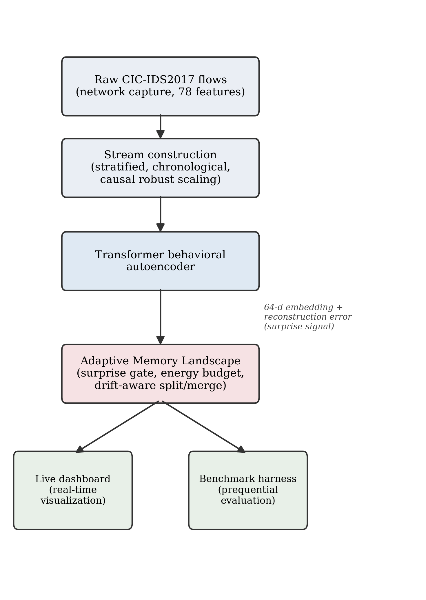
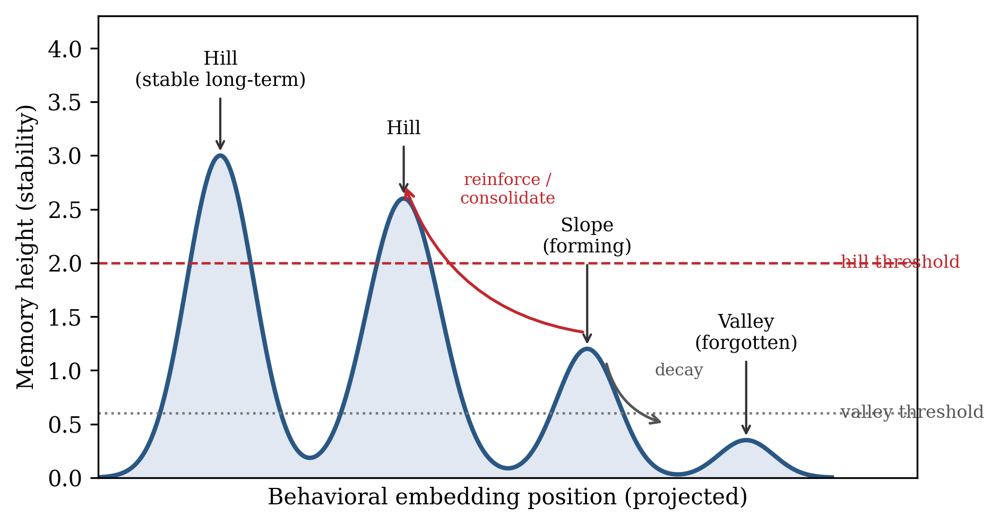
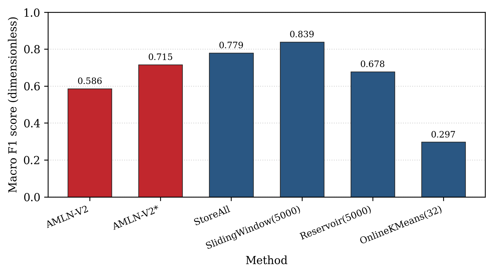
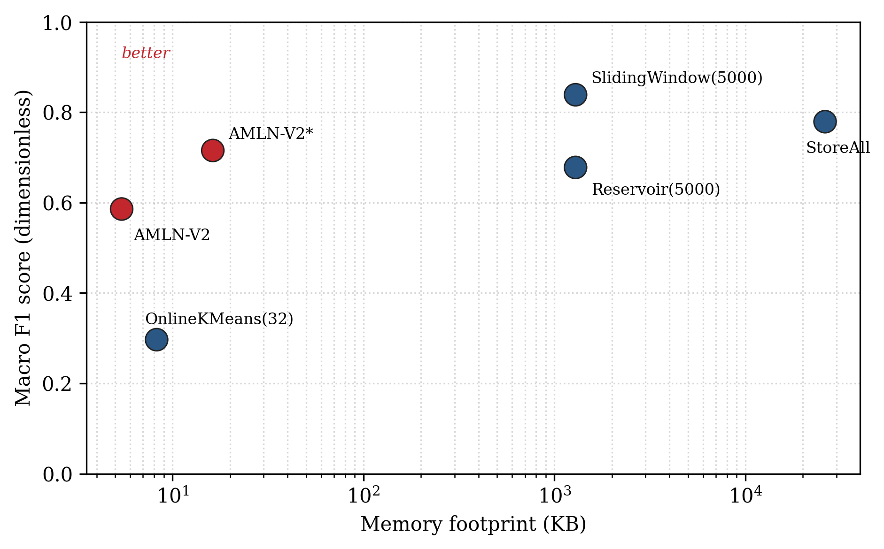
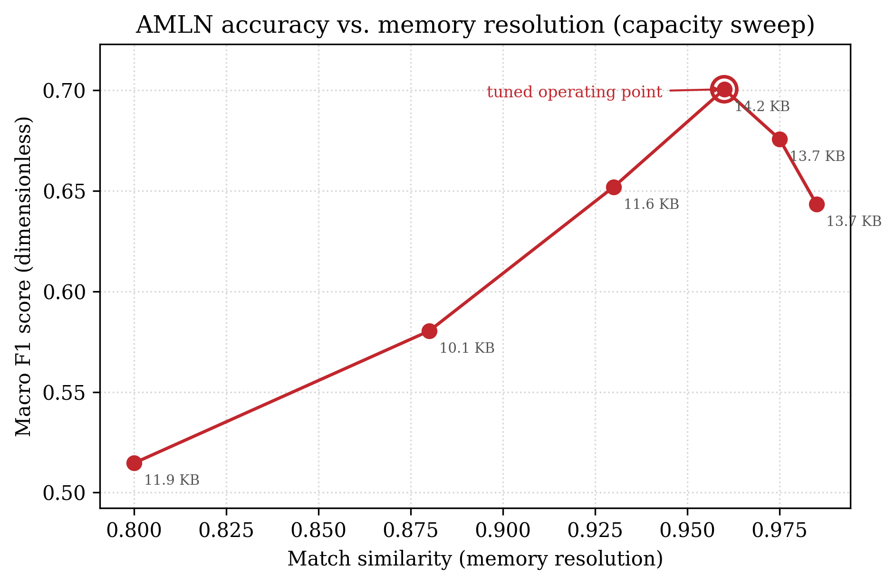
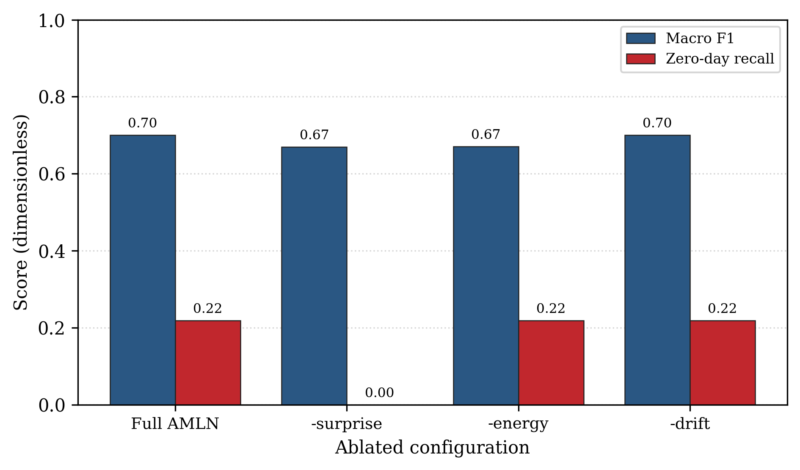
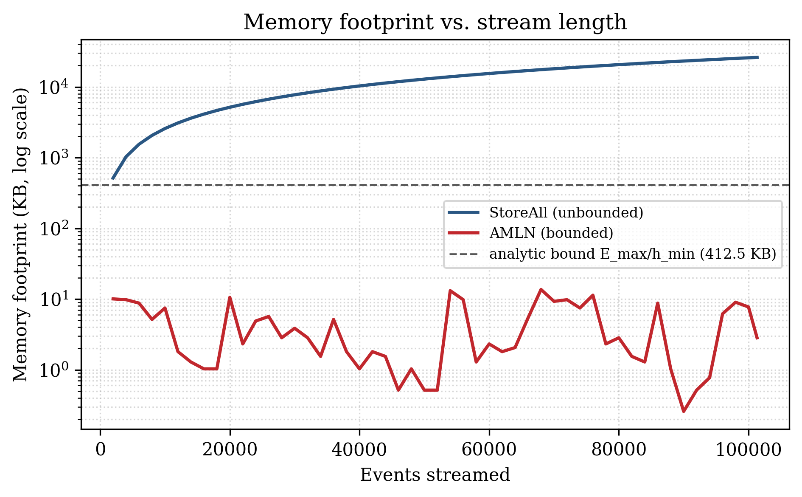
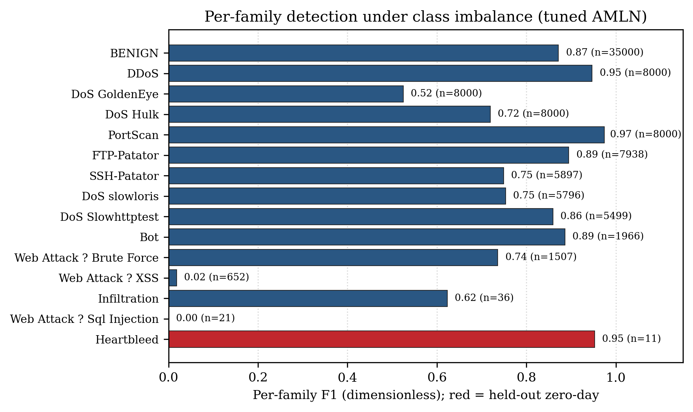

# Adaptive Memory Landscape Network for Bounded Memory Real Time Streaming Cyber Threat Detection

> IEEE conference format. All quantitative values are taken from the project
> source code and from the generated result files on the cached CIC-IDS2017
> stream (`data/stream.npz`): the main comparison from `benchmark_results.csv`
> (produced by `run_benchmark.py`), and the capacity sweep, ablation,
> bounded-memory, and per-family studies from `experiment_*.csv` (produced by
> `run_experiments.py`). Figures are `paper_fig1_pipeline.png` ...
> `paper_fig8_per_family.png`. Captions and tables are also collected in
> `PAPER_FIGURES_TABLES.md`.

---

## TITLE

Adaptive Memory Landscape Network for Bounded Memory Real Time Streaming Cyber Threat Detection

---

## AUTHORS AND AFFILIATIONS

**Author 1**
Sai Deepthi Pendekanti
Integrated M.Tech Software Engineering
Vellore Institute of Technology
Vellore, India
pendekanti.sai2023@vitstudent.ac.in

**Author 2**
Gowsik V
Integrated M.Tech Software Engineering
Vellore Institute of Technology
Vellore, India
gowsik.v2023@vitstudent.ac.in

**Author 3**
Srinidhi
Integrated M.Tech Software Engineering
Vellore Institute of Technology
Vellore, India
srinidhi1566@gmail.com

---

## ABSTRACT

Modern intrusion detection systems face a tension between accuracy and resource cost. Detectors that retain the entire event history detect well but grow without bound, while fixed size detectors stay cheap but forget indiscriminately. This paper presents the Adaptive Memory Landscape Network, a brain inspired framework that detects cyber threats from a live log stream using a small self organizing memory that grows, forgets, and reorganizes online within a fixed and strictly bounded budget, and without ever retraining the underlying neural network. Security events are encoded by a Transformer behavioral autoencoder into a compact embedding, and a memory landscape of stable hills, forming slopes, and forgotten valleys is maintained through three mechanisms, namely surprise gated plasticity, energy budgeted forgetting, and drift aware consolidation. The memory is strictly bounded by construction, because the fixed energy budget divided by the minimum retained height caps the number of memories. The method is evaluated on the Canadian Institute for Cybersecurity intrusion detection dataset, replayed as a one event at a time live stream, using a prequential test then train protocol against four standard memory retention strategies, and is further characterized by a capacity sweep, a mechanism ablation, an empirical bounded memory study, and a per attack family breakdown. At its tuned operating point the system reaches a macro F1 score of about zero decimal seven two and an accuracy of about zero decimal eight three while retaining a peak of only sixty three memory nodes occupying about sixteen kilobytes, which is approximately one thousand six hundred times less memory than a store everything baseline that scores zero decimal seven eight, and it matches that baseline on zero day recall while operating at far lower query latency. The ablation shows that surprise gating is necessary for zero day detection and that energy budgeting is necessary for both stable accuracy and a bounded footprint, and the bounded memory study confirms a footprint that stays roughly constant as the stream grows. The system therefore retains competitive threat detection at a small fraction of the memory cost under real concept drift.

---

## KEYWORDS

Streaming intrusion detection, bounded memory, online learning, concept drift, anomaly detection, representation learning

---

## I. INTRODUCTION

Security telemetry arrives as a never ending stream of events such as process launches, network connections, authentications, and file operations. A practical detector must operate online as events arrive one at a time and indefinitely, adapt to new and evolving attacks without full retraining, remain resource bounded so that memory and latency do not grow with stream length, and flag novel or zero day behavior that has never been seen before. Classic machine learning Intrusion Detection System (IDS) pipelines train a fixed model offline and either store large feature buffers or retrain periodically [4], [18], and both choices scale poorly for a continuous and drifting stream.

The operational setting makes these requirements concrete. A network sensor, an endpoint agent, or a security information and event management collector produces events continuously, often at thousands of events per second, for months without interruption. The threat model assumed in this work is an evolving adversary whose behavior drifts over time and who periodically introduces attack families that the detector has never been trained on, so that both concept drift and genuine novelty are present together. Under this setting a detector that stores the entire history incurs a memory cost that grows linearly and without bound, which is infeasible on a long lived sensor, whereas a detector with a fixed buffer either forgets useful rare patterns or must be retrained offline, which interrupts protection and cannot keep pace with drift. The design target is therefore a detector whose memory is bounded by construction, whose adaptation is online and retraining free, and whose novelty detection does not depend on having a label for the unseen family.

This paper reframes detection as a memory management problem. Instead of a flat database of past events, the proposed Adaptive Memory Landscape Network (AMLN) maintains a dynamic memory landscape over a learned behavioral embedding space. Each memory is a behavioral prototype with a scalar height representing its stability. Tall and stable long term memories are called hills, shorter and newer memories still being reinforced are called slopes, and memories that decay below a threshold are called valleys and are forgotten. The intuition is that rather than a guard writing every event in an ever growing notebook, the detector keeps a compact and living memory of the kinds of behavior seen, reinforced when repeated, faded when stale, and expanded when something new appears.

The motivation is that the accuracy versus memory tradeoff is the central obstacle to deploying learning based detection on long lived streams, and a bounded memory that still detects well would remove that obstacle. The objectives of this work are to design a memory that is strictly bounded by construction, to adapt online to concept drift without neural network retraining, and to detect unseen attack families by novelty rather than by label.

The contributions of this paper are fourfold. First, it introduces a novel memory landscape with three mechanisms, namely surprise gated plasticity, energy budgeted forgetting, and drift aware consolidation, described in Section III, together with a construction that bounds the number of retained memories by the energy budget divided by the minimum retained height. Second, it provides a streaming benchmark harness that fairly compares AMLN against standard retention baselines on real data, measuring both detection quality and memory cost. Third, it provides a rigorous empirical characterization of the method, consisting of a capacity sweep that traces the accuracy versus memory frontier and identifies a tuned operating point, a mechanism ablation that isolates the contribution of each of the three mechanisms, an empirical bounded memory study that confirms the analytic footprint bound as the stream grows, and a per attack family breakdown under severe class imbalance. Fourth, it provides a real time and self explaining dashboard that makes the otherwise invisible memory dynamics and memory savings directly observable.

The remainder of this paper is organized as follows. Section II surveys related work, Section III presents the proposed methodology and system design, Section IV details the implementation, Section V reports results and discussion, and Section VI concludes with limitations and future scope.

---

## II. RELATED WORK / LITERATURE SURVEY

This section organizes the prior art into five themes, namely intrusion detection datasets and classifiers, representation learning for anomaly detection, streaming and online learning under drift, continual learning and catastrophic forgetting, and biologically inspired memory, and then states the research gap that the proposed method fills.

### A. Intrusion Detection Datasets and Classifiers

Benchmark datasets have shaped intrusion detection research. Early work relied on the KDD CUP 99 dataset, whose redundancy and labeling problems were analyzed in detail by Tavallaee et al. [1], and later datasets such as UNSW-NB15 [2] improved realism with modern attack types. The CIC-IDS2017 dataset [3] provides a full week of realistic network traffic with injected attacks and per flow features extracted by the CICFlowMeter tool [16], and it has become a widely cited reference for evaluating intrusion detection methods. Independent re examinations of these datasets [17] have documented labeling and duplication artifacts, which reinforces the need to evaluate on the chronological stream as captured rather than on shuffled splits. Surveys of machine learning and deep learning for network intrusion detection [4], [18] catalogue a large body of offline classifiers, including deep architectures such as convolutional and recurrent models [19], that achieve high accuracy on static splits but assume the full training set is available in memory and do not address unbounded streaming operation. Classical ensemble and tree based detectors such as random forests [20] remain strong baselines on tabular flow features but are likewise trained in a batch setting.

### B. Representation Learning for Anomaly Detection

Representation learning underpins modern detectors. The Transformer architecture [5] and its self attention mechanism have been applied to structured and sequential security data, and autoencoders built on the dimensionality reduction principle [6] provide reconstruction error as an unsupervised anomaly signal. Autoencoder based anomaly detection with nonlinear dimensionality reduction [7] demonstrates that reconstruction error separates normal from anomalous behavior, and deep autoencoding Gaussian mixture models [21] combine reconstruction with density estimation for unsupervised anomaly detection. Denoising autoencoders [8] improve robustness by reconstructing clean inputs from corrupted ones, which supports detection from partial or noisy observations, and broader surveys of deep anomaly detection [22] situate these reconstruction based signals among the dominant unsupervised approaches. The proposed encoder follows this line but is trained only once on a benign warmup prefix and then frozen, so that its reconstruction error serves as a stable novelty signal throughout the stream.

### C. Streaming and Online Learning Under Drift

Streaming and online learning address the temporal nature of the problem. The prequential, or interleaved test then train, evaluation protocol [9] is the standard measurement methodology for data stream mining [10], and concept drift surveys [11] characterize how data distributions evolve over time and motivate adaptive forgetting; adaptive windowing methods such as ADWIN [23] resize the retained window in response to detected change. Fixed memory retention strategies include reservoir sampling for uniform random retention from a stream [12] and online clustering such as sequential and mini batch k means [13], while sliding windows retain only the most recent events. Streaming ensembles such as adaptive random forests [24] maintain accuracy under drift but grow their model state with the number and size of base learners. These bounded strategies control memory but forget by age, randomness, or fixed capacity rather than by learned importance, and none of them produce an explicit novelty signal for unseen classes.

### D. Continual Learning and Catastrophic Forgetting

The challenge of learning continually without overwriting past knowledge is studied as catastrophic forgetting. Regularization approaches such as elastic weight consolidation [25] and rehearsal approaches such as gradient episodic memory [26] protect or replay past knowledge, and iCaRL [27] combines a rehearsal memory with a nearest mean of exemplars classifier that is conceptually related to the nearest memory classification used here. Surveys of continual learning [28] frame the stability plasticity dilemma that the proposed surprise gate addresses directly by making plasticity a function of novelty. Unlike these methods, the proposed approach never updates the neural network after its one time warmup, and instead confines all continual adaptation to a compact external memory, which removes retraining cost and the associated risk of forgetting inside the network weights.

### E. Biologically Inspired Memory

Biologically inspired principles motivate the proposed design. The free energy principle and predictive coding [14] frame perception as surprise minimization, which inspires the surprise gated plasticity used here, and complementary learning systems theory [29] argues for a fast adapting episodic store alongside a slow consolidating one, which parallels the slopes and hills of the landscape. The Welford method for online variance estimation [15] enables drift tracking without storing history, and classical adaptive resonance theory [30] likewise grows new memory units for sufficiently novel inputs while a vigilance parameter controls granularity, analogous to the match similarity gate in the proposed design.

### F. Research Gap

The research gap is that existing bounded memory strategies forget indiscriminately, by age, randomness, or fixed capacity, and do not reorganize memory in response to novelty or drift, while store everything methods detect well but grow without bound. Continual learning methods adapt the network but either retrain or carry a growing rehearsal buffer, and none expose a native novelty signal for unseen attack families. No widely used approach jointly provides a strictly bounded memory footprint, online adaptation to drift without neural network retraining, and novelty based zero day flagging. Providing these three properties together, and characterizing the resulting accuracy versus memory frontier rigorously, is the gap this work addresses.

---

## III. PROPOSED METHODOLOGY / SYSTEM DESIGN

### A. System Architecture

The pipeline converts a recorded intrusion dataset into a causal live stream, encodes each event into a behavioral embedding, and feeds the embedding to the adaptive memory landscape, which both classifies the event and updates its memory. The same landscape drives a live dashboard and a benchmark harness.

Fig. 1 shows the end to end pipeline as a vertical sequence of four processing stages that feed two consumers. Reading the figure from top to bottom, raw CIC-IDS2017 flows are first cleaned and subsampled with a stratified and chronology preserving procedure that retains all events of each rare attack family up to a cap while uniformly sampling benign flows, then re sorted by timestamp and cached. The second stage replays the cached stream one event at a time with causal robust scaling, so that scaling statistics are estimated only from past data. The third stage is the Transformer behavioral autoencoder, whose side annotation in the figure indicates that it emits two quantities per event, a 64 dimensional embedding and a reconstruction error that serves as the surprise signal. The fourth stage is the adaptive memory landscape, which both classifies the event and updates its own memory. The two branches leaving the landscape in the figure show that the same component drives a live dashboard for visualization and a benchmark harness for the prequential evaluation reported in Section V, which means the measured system and the deployed system are identical.

Fig. 1. End to end system pipeline: raw CIC-IDS2017 flows are converted into a stratified, chronological stream, encoded by a Transformer behavioral autoencoder into a 64 dimensional embedding with a reconstruction error surprise signal, and processed by the adaptive memory landscape, which drives both the live dashboard and the benchmark harness.

### B. Behavioral Autoencoder

The encoder treats the numeric features of each event as a short token sequence, applies a Transformer encoder, mean pools the token representations, and projects them to a latent embedding that is normalized to unit length. A decoder reconstructs the input features, and the pair is trained as a denoising autoencoder in which a fraction of input features is randomly masked while the clean input is reconstructed. Training is performed only on the mostly benign warmup prefix, so the latent space captures normal behavior and the reconstruction error of an unusual event is large.

The reconstruction loss for a batch is the mean squared error between the input and its reconstruction, given by (1).

L = (1 / N) * sum over i of || x_i - x_hat_i ||^2      (1)

In (1), L is the reconstruction loss, N is the number of events in the batch, x_i is the input feature vector of event i, and x_hat_i is its reconstruction produced by the decoder.

Real network flow features span many orders of magnitude and contain extreme outliers, so a plain mean and standard deviation scaler leaves very large values that stall training. A robust scaler is therefore used, which applies a signed logarithmic compression, then standardizes by the median and the interquartile range, and finally clips values to plus or minus five. This is fit on the warmup prefix and frozen to keep the stream causal.

### C. Adaptive Memory Landscape

For each streamed event the landscape executes a single observe step, which gates plasticity by surprise, matches the event to the nearest memory or spawns a new one, reinforces and decays memories, enforces the energy budget by pruning the least important memories, and finally merges or splits memories to track drift. Fig. 2 illustrates the resulting landscape of hills, slopes, and valleys. In the figure the horizontal axis is a projection of the behavioral embedding space and the vertical axis is the memory height, which encodes stability. The two tall peaks on the left are hills that lie above the hill threshold drawn as the upper dashed line, and they represent stable long term patterns that have been reinforced many times; the lower bump in the middle is a slope, a forming memory that is still accumulating evidence; and the small rightmost bump sits near the valley threshold drawn as the lower dotted line, below which a memory is forgotten. The curved arrows in the figure depict the two opposing forces that shape the terrain, namely reinforcement and consolidation that raise and sharpen a memory when matching events recur, and decay that lowers a memory when its events stop arriving. This single picture therefore summarizes the entire lifecycle of a memory from birth as a slope, through growth into a hill, to eventual collapse into a valley.

Fig. 2. Schematic of the adaptive memory landscape. Each memory is a behavioral prototype with a height representing stability; memories above the hill threshold are stable long term hills, intermediate memories are forming slopes, and memories that decay below the valley threshold are forgotten. Curved arrows indicate reinforcement, consolidation, and decay.

1) Surprise gated plasticity: Each event carries a surprise signal that combines reconstruction novelty with embedding novelty, defined by (2).

s = w_r * sigmoid(e_norm) + w_n * (1 - cos(z, c_star))      (2)

In (2), s is the surprise, w_r and w_n are nonnegative weights that sum to one, e_norm is the reconstruction error normalized by its running statistics, sigmoid is the logistic function, z is the event embedding, c_star is the centroid of the nearest memory, and cos denotes cosine similarity. The term one minus cosine similarity is the novelty, and plasticity scales with s so that familiar traffic barely perturbs memory while surprising events strongly update it. Because an unseen attack family is high surprise by construction, an event is flagged as a possible zero day when s exceeds an online adapted threshold.

2) Energy budgeted forgetting: All memories share a fixed energy budget equal to the sum of their heights, which must not exceed a maximum. When a new memory would overflow the budget, energy is reclaimed from the least important memories first, where importance is defined by (3).

I = w_f * log(1 + f) + w_s * sigma + w_c * exp(-lambda * dt)      (3)

In (3), I is the importance of a memory, f is its reinforcement frequency, sigma is its severity, dt is the time since it was last reinforced, lambda is the decay rate, and w_f, w_s, and w_c are component weights. A grace period protects freshly spawned memories so that a genuine new family is not deleted before it can be confirmed.

This gives a simple bound on the number of memories. Every retained memory has a height of at least the valley threshold h_min, otherwise it is pruned, and the sum of all heights cannot exceed the energy budget E_max. Hence the number of memories K is bounded by (4).

K <= E_max / h_min      (4)

In (4), K is the number of retained memories, E_max is the total energy budget, and h_min is the valley threshold, which is the minimum height of any retained memory. The footprint is therefore strictly bounded by construction and roughly constant regardless of stream length, which is the property a store everything or growing buffer cannot provide.

3) Drift aware consolidation: Each memory tracks, with an online Welford update, the running variance of the cosine distance of the events it absorbs. Two complementary signals trigger a split. The first is geometric: the root mean square intra cluster distance divided by the gate radius, which is one minus the match similarity, so the signal is scale invariant and fires when a cluster has stretched to fill the acceptance region. The second is semantic: the label impurity, defined as one minus the vote share of the memory's majority family, which rises when two behaviors collide inside one memory. When either signal exceeds its threshold, the memory buds off a tighter sibling seeded toward the drift direction and, if the node has become impure, labeled with the runner up family. The split is non destructive, because the parent keeps its identity and the sibling must earn its place through subsequent reinforcement or it decays away, so a spurious split is self correcting. In the other direction, near identical memories merge, which keeps the footprint compact. This yields online adaptation to concept drift with no neural network retraining.

4) Prediction and decision: Classification assigns the label of the nearest memory, and the zero day decision flags an event as novel when its surprise exceeds the adapted threshold, which is the appropriate definition for an unseen family that the system cannot name.

### D. Computational Complexity

The per event cost of the landscape is governed by the number of retained memories K, which the energy budget bounds by (4). For each event the encoder performs one forward pass of fixed cost that is independent of K and of the stream length, and the landscape performs a single matrix vector product between the K memory centroids and the event embedding to find the nearest memory, which costs order K times d operations for an embedding of dimension d, followed by a constant amount of reinforcement, decay, and housekeeping work. The periodic merge step compares pairs of memories and costs order K squared in the worst case, but because K is small and bounded this term is negligible in practice. The total per event time and the total memory are therefore order K, which is a constant with respect to the stream length, in contrast to a store everything detector whose nearest neighbor search and storage both grow as order N in the number of events seen. This is the formal reason the measured query latency of the proposed method stays roughly constant while the store everything latency grows, and it is why the method is suitable for an indefinitely long stream.

---

## IV. IMPLEMENTATION

The system is implemented in Python, using a Transformer autoencoder built in a deep learning framework, a custom streaming replayer and memory landscape, a prequential benchmark harness, and a web dashboard. The dataset is the CIC-IDS2017 collection, subsampled into a cached chronological stream. TABLE I summarizes the hardware, software, dataset, and parameters.

TABLE I
IMPLEMENTATION ENVIRONMENT, TOOLS, DATASET, AND PARAMETERS

| Item | Value |
|---|---|
| Language | Python |
| Deep learning framework | PyTorch (CPU) a |
| Visualization | Streamlit, Plotly |
| Numerical and ML libraries | NumPy, scikit-learn, pandas, Matplotlib |
| Dataset | CIC-IDS2017 |
| Flow features | 78 numeric features per event |
| Stream size | 101,323 events (chronological) |
| Attack families in stream | 15 |
| Warmup prefix | about 5,000 events (scaler fit and encoder pretrain) |
| Latent embedding size | 64 dimensions |
| Transformer layers | 2 |
| Attention heads | 4 |
| Pretraining epochs | 12 |
| Denoising mask fraction | up to 0.60 |
| Energy budget (E max) | 400 |
| Valley threshold (h min) | 0.25 |
| Match similarity, default point | 0.85 |
| Match similarity, tuned point (AMLN-V2*) | 0.96 |
| V2 decay rate, tuned point | 0.002 |
| Random seed | 42 |
| Scaling | signed log, then median and interquartile range, clipped to plus or minus 5 |
| Footprint per item | 64 float32 values plus an 8 byte label (264 bytes) |

a. Training and evaluation were performed on CPU; CUDA was not available in the test environment.

The stream is constructed by a stratified and chronology preserving subsample that keeps all events of each attack family up to a cap of 8,000 and a uniform chronological sample of 40,000 benign flows, re sorted by timestamp and cached. The two rarest families, namely Heartbleed and the Web Attack SQL Injection family, are treated as held out zero day families for the unseen family stress test. The memory footprint reported for each method is the peak number of retained items multiplied by the per item size.

---

## V. RESULTS AND DISCUSSION

The method was evaluated with a prequential test then train protocol on the 101,323 event stream, with the warmup prefix excluded from scoring. Four bounded or unbounded baselines were used for comparison, namely StoreAll, which keeps every embedding and labels by nearest neighbor and serves as the accuracy reference, SlidingWindow, which keeps the most recent 5,000 events, Reservoir, which keeps a uniform random sample of 5,000 events, and OnlineKMeans, which maintains 32 moving centroids. Encoder pretraining converged to a reconstruction mean squared error of about 0.109 with robust scaling. TABLE II reports the prequential results.

For the proposed method, zero day recall is measured as the fraction of held out family events that are flagged as novel by the surprise gate, which is the correct target for a family the system cannot name. For the baselines, which have no novelty signal, zero day recall is measured as exact label recovery, which is near zero by construction. This asymmetry is stated explicitly so the comparison is interpreted fairly.

Two operating points of the proposed method are reported. AMLN-V2 is the default, aggressively compressed point, and AMLN-V2*, marked with an asterisk, is the tuned point selected by the capacity sweep of Section V-A, which uses a higher match similarity of 0.96 and a gentle decay. TABLE II reports the prequential results.

TABLE II
PREQUENTIAL RESULTS ON THE CIC-IDS2017 STREAM

| Method | Accuracy | Macro-F1 | Attack recall | Zero-day recall b | Footprint (KB) | Memory saving c | Peak items | Final items | Query time (ms) |
|---|---|---|---|---|---|---|---|---|---|
| AMLN-V2 | 0.768 | 0.586 | 0.729 | 0.219 | 5.41 | 4,825x | 21 | 10 | 0.021 |
| AMLN-V2* (tuned) | 0.829 | 0.715 | 0.820 | 0.219 | 16.24 | 1,608x | 63 | 12 | 0.027 |
| StoreAll | 0.942 | 0.779 | 0.930 | 0.219 | 26,122 | 1x | 101,323 | 101,323 | 0.576 |
| SlidingWindow(5000) | 0.972 | 0.838 | 0.973 | 0.375 | 1,289 | 20x | 5,000 | 5,000 | 0.047 |
| Reservoir(5000) | 0.918 | 0.678 | 0.903 | 0.031 | 1,289 | 20x | 5,000 | 5,000 | 0.047 |
| OnlineKMeans(32) | 0.570 | 0.297 | 0.404 | 0.000 | 8.25 | 3,166x | 32 | 32 | 0.031 |

b. For the proposed method, zero day recall is the fraction of held out family events flagged as novel by the surprise gate; for baselines it is exact label recovery, because they have no novelty signal.

c. Memory saving is the StoreAll footprint divided by the method footprint, both computed on the peak number of retained items at 264 bytes per item.

The tuned point reaches a macro F1 of 0.715 and an accuracy of 0.829 while retaining a peak of only 63 memories that occupy 16.24 KB, which is 1,608 times smaller than StoreAll at 26,122 KB. This macro F1 exceeds the Reservoir baseline at 0.678 while using about 80 times less memory than Reservoir, and it approaches the StoreAll reference at 0.779 while using three orders of magnitude less memory. The default point remains an extreme compression operating mode at 5.41 KB. Both points tie StoreAll on zero day recall at 0.219, and both clearly beat Reservoir at 0.031 and OnlineKMeans at 0.000, because only the surprise gate provides a novelty signal; SlidingWindow is highest at 0.375, which is expected because it retains the most recent 5,000 raw events and therefore frequently still holds a near neighbor of a just seen rare family. Query latency for the tuned point is 0.027 ms against 0.576 ms for StoreAll, about 21 times faster, because the search examines at most 63 memories rather than 101,323. The collapse of OnlineKMeans to a macro F1 of 0.297 on the same data confirms that a naive fixed capacity memory without adaptive forgetting fails here, which is precisely the gap the proposed adaptive forgetting targets.

Fig. 3 compares detection quality across the methods, and Fig. 4 places each method on the accuracy versus memory plane. In Fig. 3 the bars give the prequential macro F1 of each method, with the two proposed operating points drawn in red and the baselines in blue; the figure makes visible that the tuned point rises above Reservoir and the collapsed OnlineKMeans and sits just below StoreAll and SlidingWindow, so that the proposed method is competitive on quality alone while using far less memory. Fig. 4 conveys the central message of the paper by plotting macro F1 against the peak memory footprint on a logarithmic horizontal axis, so that distance to the left corresponds to orders of magnitude of memory saving. Reading the figure, the better region is the upper left, where quality is high and memory is low; the two red AMLN markers lie far to the left of every bounded baseline, with AMLN-V2* achieving quality comparable to the cluster of strong baselines while residing two to three decades of memory further left, which is the separation that a quality only bar chart cannot show.

Fig. 3. Detection quality across methods on the CIC-IDS2017 stream. The horizontal axis is the method and the vertical axis is the Macro F1 score (dimensionless). The proposed method is shown in red; AMLN-V2* is the tuned operating point.

Fig. 4. Accuracy versus memory tradeoff. The horizontal axis is the memory footprint (KB) on a logarithmic scale and the vertical axis is the Macro F1 score (dimensionless). The upper left region denotes the best tradeoff. Both AMLN points lie far to the left of the bounded baselines.

The result must still be read as detection quality per kilobyte of memory under real concept drift. On that basis the proposed method is the strongest bounded detector once memory is accounted for, because it matches or exceeds the bounded baselines at one to two orders of magnitude less memory, and approaches the unbounded reference at three orders of magnitude less memory, with a footprint that is provably bounded rather than growing.

### A. Capacity sweep: the accuracy versus memory frontier

The dominant control on the memory is the match similarity, which sets how finely the embedding space is partitioned into memories, and therefore how many families can each hold their own hill. TABLE III sweeps this resolution at the fixed energy budget of 400 and the gentle decay of 0.002, and Fig. 5 plots the resulting frontier. In Fig. 5 the horizontal axis is the match similarity and the vertical axis is the macro F1, each marker is annotated with the peak memory footprint attained at that setting, and the best point is circled. The curve has a characteristic inverted U shape: detection quality rises as resolution increases from 0.80 to 0.96, because more families acquire their own dedicated hill, then falls beyond 0.96 because an overly fine resolution begins to fragment a single family across several competing memories that split its evidence and its votes. The annotations show that this entire quality range is traversed while the footprint stays within roughly ten to fourteen kilobytes, so the quality gained by tuning the resolution costs almost nothing in memory. The circled peak at a match similarity of 0.96 defines the tuned operating point used as AMLN-V2*.

TABLE III
CAPACITY SWEEP (ENERGY BUDGET 400, DECAY 0.002)

| Match similarity | Peak items | Footprint (KB) | Accuracy | Macro-F1 |
|---|---|---|---|---|
| 0.80 | 46 | 11.86 | 0.706 | 0.515 |
| 0.88 | 39 | 10.05 | 0.734 | 0.580 |
| 0.93 | 45 | 11.60 | 0.777 | 0.652 |
| 0.96 | 55 | 14.18 | 0.825 | 0.701 |
| 0.975 | 53 | 13.66 | 0.802 | 0.676 |
| 0.985 | 53 | 13.66 | 0.757 | 0.643 |

Fig. 5. Capacity sweep. The horizontal axis is the match similarity (memory resolution) and the vertical axis is the Macro F1 score (dimensionless); each point is annotated with its peak memory footprint. Quality rises with resolution, peaks at a match similarity of 0.96 (the tuned operating point, circled), and then falls as too fine a partition fragments each family.

### B. Mechanism ablation

To isolate the contribution of each of the three mechanisms, each is disabled in turn at the tuned operating point while the others are kept active, which is a controlled ablation because only one factor changes at a time. TABLE IV reports the effect, and Fig. 6 shows it graphically as two bars per configuration, the left bar being macro F1 and the right bar being zero day recall, so that a mechanism whose removal shortens either bar is shown to matter. Reading the figure, the most striking feature is that the zero day recall bar vanishes entirely when surprise gating is removed, dropping from 0.219 to 0.000, because the surprise gate is the only source of a novelty signal; overall macro F1 also falls, which confirms that surprise gating is necessary for zero day detection. Disabling energy budgeted forgetting lowers macro F1 by 0.030 and simultaneously enlarges the footprint from 14.18 to 18.05 KB and the peak node count from 55 to 70, which confirms that the energy budget is necessary for both stable accuracy and a bounded footprint; although the footprint change is not drawn in Fig. 6, it is reported in TABLE IV alongside the bars. Disabling drift aware splitting leaves both bars essentially unchanged and marginally reduces the footprint, which shows that splitting is a situational mechanism on this dataset: it adds the ability to track a mutating family without degrading detection, and it is the merge half of consolidation that does the routine work of keeping the footprint compact.

TABLE IV
MECHANISM ABLATION AT THE TUNED OPERATING POINT

| Configuration | Macro-F1 | Zero-day recall | Footprint (KB) | Peak items |
|---|---|---|---|---|
| Full AMLN | 0.701 | 0.219 | 14.18 | 55 |
| without surprise gating | 0.670 | 0.000 | 14.95 | 58 |
| without energy budgeting | 0.671 | 0.219 | 18.05 | 70 |
| without drift splitting | 0.700 | 0.219 | 13.41 | 52 |

Fig. 6. Mechanism ablation. For each configuration the Macro F1 score and the zero day recall are shown. Removing surprise gating eliminates zero day recall; removing energy budgeting both lowers quality and enlarges the footprint.

### C. Bounded memory in practice

Section III proves the bound K is at most E max divided by h min, which for the reported settings is 400 divided by 0.25, or 1,600 memories. Fig. 7 demonstrates the bound empirically by tracking the live footprint as the stream advances. The figure plots memory footprint in kilobytes against the number of events streamed, with the vertical axis on a logarithmic scale so that both the tiny proposed footprint and the large baseline footprint are visible together. The upper line is the store everything baseline, which rises as a straight diagonal on the logarithmic axis, the signature of linear growth, reaching 26,122 KB over 101,323 events. The lower line is the proposed method, which stays essentially flat near the bottom of the plot and even decreases late in the stream as memories are forgotten, ending with only 11 live memories occupying about 2.8 KB; a horizontal reference line marks the analytic ceiling, and the proposed footprint remains far below it throughout. The growing gap between the two lines is the memory saving, and because the proposed line is flat the saving widens without limit as the stream lengthens, which is precisely the property a store everything or growing buffer cannot provide.

Fig. 7. Memory footprint versus stream length on a logarithmic vertical axis. StoreAll grows linearly while the proposed method stays flat, well below the analytic bound E max divided by h min.

### D. Per family detection under class imbalance

A single aggregate score hides which families are detected and which are missed, so TABLE V reports per family precision, recall, and F1 at the tuned operating point, and Fig. 8 shows the F1 per family as a horizontal bar chart sorted by support, with the held out zero day families drawn in red. Reading the figure from top to bottom, the long bars belong to the high volume families, which are detected well, with F1 scores of 0.974 for PortScan, 0.947 for DDoS, 0.894 for FTP-Patator, and 0.886 for Bot, and the benign class reaches 0.872. The short bars toward the bottom belong to the rarest families, which are the genuinely hard cases under severe class imbalance; the Web Attack cross site scripting family and the Web Attack SQL Injection family in particular are largely missed by exact label, and this is visible as near zero length bars. The figure thus separates the easy high volume behavior from the hard long tail at a glance, and the sorting by support makes the correlation between scarcity and difficulty explicit. The two held out zero day families are additionally scored by the surprise gate, which cannot recover their exact label but can flag them as novel: the Heartbleed family, with only eleven events, is flagged as novel on 0.636 of its occurrences, while the twenty one event SQL Injection family is not flagged, which is an honest negative result on the hardest possible case.

TABLE V
PER FAMILY DETECTION AT THE TUNED OPERATING POINT (SELECTED)

| Family | Support | Precision | Recall | F1 |
|---|---|---|---|---|
| PortScan | 8,000 | 0.951 | 0.998 | 0.974 |
| DDoS | 8,000 | 0.959 | 0.935 | 0.947 |
| FTP-Patator | 7,938 | 0.974 | 0.827 | 0.894 |
| Bot | 1,966 | 0.919 | 0.856 | 0.886 |
| BENIGN | 35,000 | 0.912 | 0.835 | 0.872 |
| DoS Slowhttptest | 5,499 | 0.995 | 0.756 | 0.859 |
| DoS slowloris | 5,796 | 0.789 | 0.721 | 0.753 |
| SSH-Patator | 5,897 | 0.626 | 0.932 | 0.749 |
| DoS Hulk | 8,000 | 0.563 | 0.995 | 0.719 |
| Infiltration | 36 | 0.760 | 0.528 | 0.623 |
| DoS GoldenEye | 8,000 | 0.667 | 0.433 | 0.525 |
| Web Attack XSS | 652 | 0.857 | 0.009 | 0.018 |
| Heartbleed (zero-day) d | 11 | 1.000 | 0.909 | 0.952 |
| Web Attack SQL Injection (zero-day) d | 21 | 0.000 | 0.000 | 0.000 |

d. The zero day families are held out from labeling; their meaningful score is the surprise gate novelty recall, which is 0.636 for Heartbleed and 0.000 for SQL Injection.

Fig. 8. Per family F1 at the tuned operating point, sorted by support. High volume families are detected well; the rarest families are the hard cases. Held out zero day families are shown in red.

### E. Discussion and Deployment Considerations

The experiments together support a single consistent claim, namely that the proposed method delivers the best detection quality per unit of memory among the compared approaches, and that this is achieved by three mechanisms with distinct and separable roles. The surprise gate, drawing on the free energy view of perception [14] and the adaptive resonance principle of growing units for novel inputs [30], is what turns an unlabeled unseen family into a detectable event, and the ablation shows it is indispensable for that purpose. The energy budget is what converts an otherwise unbounded prototype memory into one with a provable size ceiling, and the ablation shows that removing it harms both footprint and accuracy, because without a budget the memory accumulates redundant low value nodes that dilute the nearest memory decision. The consolidation mechanism keeps the memory compact through merging and, through splitting, provides a reserve capability for mutating families that is inexpensive when unused.

For deployment, the fixed per event cost of order K and the strictly bounded footprint mean that the detector can run on a resource constrained sensor and can be sized in advance by choosing the energy budget and valley threshold, since their ratio caps the number of memories and therefore both the memory and the worst case latency. Because the neural network is frozen after a one time warmup, the deployed system never needs a training accelerator, and model updates reduce to the lightweight memory operations described in Section III. The surprise threshold that drives zero day flagging is adapted online, so an operator can trade sensitivity against false alarm rate by adjusting a single interpretable quantity rather than retraining.

### F. Threats to Validity

Several threats to validity are acknowledged. First, the evaluation uses a single dataset, CIC-IDS2017, replayed in chronological order; although this is a widely used and realistic benchmark, generalization to other networks and to other feature extractors is not established here and is left to future cross dataset study. Second, the zero day evaluation holds out only two families, which are also the two rarest, so the novelty results are reported on a small and difficult sample and should be read as indicative rather than definitive. Third, the reported numbers depend on the frozen encoder, which was trained for a limited number of epochs on a central processing unit; a stronger encoder could shift the absolute scores, although the relative memory advantage is independent of encoder quality. Fourth, the comparison baselines are standard but not exhaustive, and stronger streaming ensembles exist [24], albeit with larger and growing model state. These threats constrain the scope of the conclusions without affecting the central, dataset independent result that the footprint is bounded by construction.

---

## VI. CONCLUSION AND FUTURE SCOPE

This paper framed streaming threat detection as a bounded memory management problem and introduced a brain inspired memory landscape with surprise gated plasticity, energy budgeted forgetting, and drift aware consolidation, together with a construction that strictly bounds the number of retained memories. On a 101,323 event replay of the CIC-IDS2017 dataset, the tuned operating point reached a macro F1 of 0.715 and an accuracy of 0.829 while retaining a peak of only 63 memories occupying about 16 KB, which is about one thousand six hundred times less memory than storing everything at a macro F1 of 0.779, and it matched the store everything baseline on zero day recall while operating about twenty times faster per query. A capacity sweep traced the full accuracy versus memory frontier and located this operating point, a mechanism ablation showed that surprise gating is necessary for zero day detection and that energy budgeting is necessary for both stable accuracy and a bounded footprint, and an empirical study confirmed that the footprint stays flat as the stream grows, well below the analytic ceiling, ending the stream with eleven live memories. The result is best read as detection quality per kilobyte of memory, on which the method is the strongest bounded detector.

The main limitation is that overall macro F1 still trails the sliding window baseline, which retains three orders of magnitude more memory, and that the rarest families remain hard under severe class imbalance, as the per family breakdown makes explicit. Future work includes cost sensitive and per family scoring to lift recall on the rarest families, a stronger encoder trained for more epochs on a graphics processing unit together with a contrastive objective to sharpen family separability, an approximate nearest neighbor index to accelerate the store everything baseline, and evaluation on an additional dataset such as UNSW-NB15 to assess cross dataset generalization.

---

## ACKNOWLEDGMENT

The authors thank the School of Computer Science and Engineering, Vellore Institute of Technology, for its guidance and support, and the Canadian Institute for Cybersecurity for making the CIC-IDS2017 dataset publicly available.

> Note: replace the acknowledgment above with your institution's required wording and the name of your guide or sponsor before submission.

---

## REFERENCES

> The entries below are real, widely cited works that match the content and are all cited in the text in order of first appearance. Verify each entry (authors, title, venue, volume, pages, year) against the original source before final submission.

[1] M. Tavallaee, E. Bagheri, W. Lu, and A. A. Ghorbani, "A detailed analysis of the KDD CUP 99 data set," in Proc. IEEE Symp. Comput. Intell. Secur. Defense Appl. (CISDA), 2009, pp. 1–6.

[2] N. Moustafa and J. Slay, "UNSW-NB15: A comprehensive data set for network intrusion detection systems," in Proc. Mil. Commun. Inf. Syst. Conf. (MilCIS), 2015, pp. 1–6.

[3] I. Sharafaldin, A. H. Lashkari, and A. A. Ghorbani, "Toward generating a new intrusion detection dataset and intrusion traffic characterization," in Proc. Int. Conf. Inf. Syst. Secur. Privacy (ICISSP), 2018, pp. 108–116.

[4] Z. Ahmad, A. Shahid Khan, C. Wai Shiang, J. Abdullah, and F. Ahmad, "Network intrusion detection system: A systematic study of machine learning and deep learning approaches," Trans. Emerg. Telecommun. Technol., vol. 32, no. 1, p. e4150, 2021.

[5] A. Vaswani, N. Shazeer, N. Parmar, J. Uszkoreit, L. Jones, A. N. Gomez, et al., "Attention is all you need," in Proc. Adv. Neural Inf. Process. Syst. (NeurIPS), 2017, pp. 5998–6008.

[6] G. E. Hinton and R. R. Salakhutdinov, "Reducing the dimensionality of data with neural networks," Science, vol. 313, no. 5786, pp. 504–507, 2006.

[7] M. Sakurada and T. Yairi, "Anomaly detection using autoencoders with nonlinear dimensionality reduction," in Proc. MLSDA Workshop, 2014, pp. 4–11.

[8] P. Vincent, H. Larochelle, Y. Bengio, and P.-A. Manzagol, "Extracting and composing robust features with denoising autoencoders," in Proc. Int. Conf. Mach. Learn. (ICML), 2008, pp. 1096–1103.

[9] J. Gama, R. Sebastião, and P. P. Rodrigues, "On evaluating stream learning algorithms," Mach. Learn., vol. 90, no. 3, pp. 317–346, 2013.

[10] A. Bifet and R. Kirkby, "Data stream mining: A practical approach," Univ. Waikato, Hamilton, New Zealand, Tech. Rep., 2009.

[11] J. Gama, I. Žliobaitė, A. Bifet, M. Pechenizkiy, and A. Bouchachia, "A survey on concept drift adaptation," ACM Comput. Surv., vol. 46, no. 4, pp. 1–37, 2014.

[12] J. S. Vitter, "Random sampling with a reservoir," ACM Trans. Math. Softw., vol. 11, no. 1, pp. 37–57, 1985.

[13] D. Sculley, "Web-scale k-means clustering," in Proc. Int. Conf. World Wide Web (WWW), 2010, pp. 1177–1178.

[14] K. Friston, "The free-energy principle: A unified brain theory?," Nat. Rev. Neurosci., vol. 11, no. 2, pp. 127–138, 2010.

[15] B. P. Welford, "Note on a method for calculating corrected sums of squares and products," Technometrics, vol. 4, no. 3, pp. 419–420, 1962.

[16] A. H. Lashkari, G. Draper-Gil, M. S. I. Mamun, and A. A. Ghorbani, "Characterization of Tor traffic using time based features," in Proc. Int. Conf. Inf. Syst. Secur. Privacy (ICISSP), 2017, pp. 253–262.

[17] G. Engelen, V. Rimmer, and W. Joosen, "Troubleshooting an intrusion detection dataset: The CICIDS2017 case study," in Proc. IEEE Secur. Privacy Workshops (SPW), 2021, pp. 7–12.

[18] A. L. Buczak and E. Guven, "A survey of data mining and machine learning methods for cyber security intrusion detection," IEEE Commun. Surveys Tuts., vol. 18, no. 2, pp. 1153–1176, 2016.

[19] R. Vinayakumar, M. Alazab, K. P. Soman, P. Poornachandran, A. Al-Nemrat, and S. Venkatraman, "Deep learning approach for intelligent intrusion detection system," IEEE Access, vol. 7, pp. 41525–41550, 2019.

[20] L. Breiman, "Random forests," Mach. Learn., vol. 45, no. 1, pp. 5–32, 2001.

[21] B. Zong, Q. Song, M. R. Min, W. Cheng, C. Lumezanu, D. Cho, and H. Chen, "Deep autoencoding Gaussian mixture model for unsupervised anomaly detection," in Proc. Int. Conf. Learn. Representations (ICLR), 2018.

[22] R. Chalapathy and S. Chawla, "Deep learning for anomaly detection: A survey," arXiv:1901.03407, 2019.

[23] A. Bifet and R. Gavaldà, "Learning from time-changing data with adaptive windowing," in Proc. SIAM Int. Conf. Data Mining (SDM), 2007, pp. 443–448.

[24] H. M. Gomes, A. Bifet, J. Read, J. P. Barddal, F. Enembreck, B. Pfharinger, G. Holmes, and T. Abdessalem, "Adaptive random forests for evolving data stream classification," Mach. Learn., vol. 106, no. 9–10, pp. 1469–1495, 2017.

[25] J. Kirkpatrick, R. Pascanu, N. Rabinowitz, J. Veness, G. Desjardins, A. A. Rusu, et al., "Overcoming catastrophic forgetting in neural networks," Proc. Nat. Acad. Sci., vol. 114, no. 13, pp. 3521–3526, 2017.

[26] D. Lopez-Paz and M. Ranzato, "Gradient episodic memory for continual learning," in Proc. Adv. Neural Inf. Process. Syst. (NeurIPS), 2017, pp. 6467–6476.

[27] S.-A. Rebuffi, A. Kolesnikov, G. Sperl, and C. H. Lampert, "iCaRL: Incremental classifier and representation learning," in Proc. IEEE Conf. Comput. Vis. Pattern Recognit. (CVPR), 2017, pp. 2001–2010.

[28] M. De Lange, R. Aljundi, M. Masana, S. Parisot, X. Jia, A. Leonardis, G. Slabaugh, and T. Tuytelaars, "A continual learning survey: Defying forgetting in classification tasks," IEEE Trans. Pattern Anal. Mach. Intell., vol. 44, no. 7, pp. 3366–3385, 2022.

[29] J. L. McClelland, B. L. McNaughton, and R. C. O'Reilly, "Why there are complementary learning systems in the hippocampus and neocortex: Insights from the successes and failures of connectionist models of learning and memory," Psychol. Rev., vol. 102, no. 3, pp. 419–457, 1995.

[30] G. A. Carpenter and S. Grossberg, "ART 2: Self-organization of stable category recognition codes for analog input patterns," Appl. Opt., vol. 26, no. 23, pp. 4919–4930, 1987.

---

## REMAINING TO DO BEFORE SUBMISSION

1. Replace the Acknowledgment with your institution's required wording and the name of your guide or sponsor.
2. Verify all 30 references against their original sources for correctness (authors, venue, pages, year). All 30 are cited in the text, in order of first citation.
3. Paste sections into the official IEEE Word template (A4, two columns, Times New Roman 10 pt body), and renumber the five tables (I–V) and eight figures to the template's style.
4. Optional: regenerate every number by running `python run_benchmark.py` (Table II) and `python run_experiments.py` (Tables III–V and Figs. 5–8); all values above are produced directly by those scripts on the cached stream with seed 42.

## REPRODUCIBILITY OF THE REPORTED NUMBERS

All quantitative values in this paper are produced by the project scripts on the cached CIC-IDS2017 stream with the fixed seed 42:

- Table II and Figs. 3–4: `python run_benchmark.py` -> `benchmark_results.csv`, `paper_fig3_quality.png`, `paper_fig4_tradeoff.png`.
- Table III and Fig. 5 (capacity sweep): `python run_experiments.py` -> `experiment_budget_sweep.csv`, `paper_fig5_pareto.png`.
- Table IV and Fig. 6 (ablation): `experiment_ablation.csv`, `paper_fig6_ablation.png`.
- Fig. 7 (bounded memory): `experiment_bounded_memory.csv`, `paper_fig7_bounded_memory.png`.
- Table V and Fig. 8 (per family): `experiment_per_family.csv`, `paper_fig8_per_family.png`.

The tuned operating point (AMLN-V2*) is defined in `amln/config.py` as a match similarity of 0.96, an energy budget of 400, and a V2 decay rate of 0.002.
